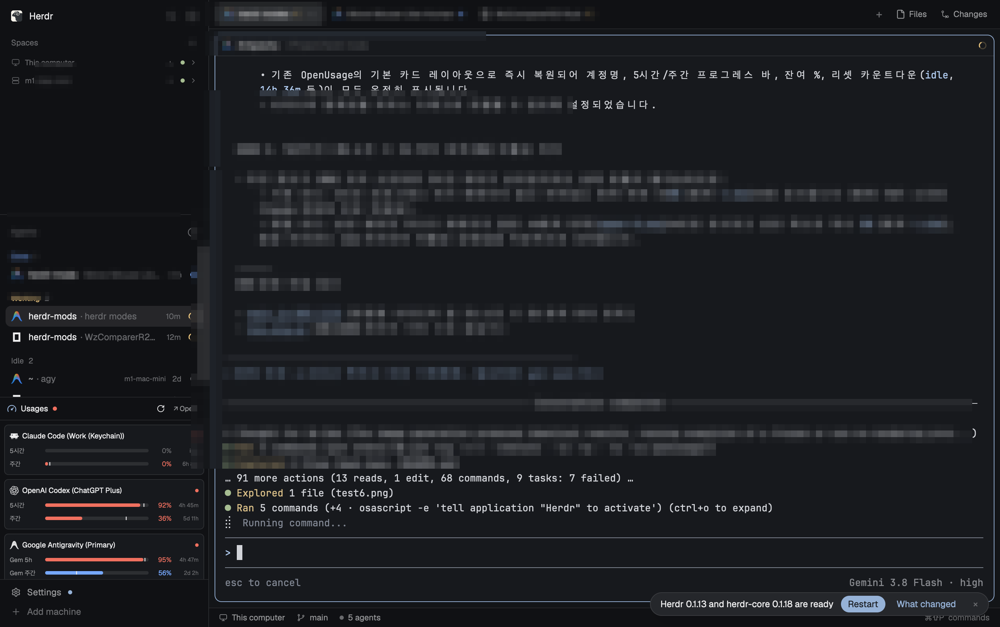
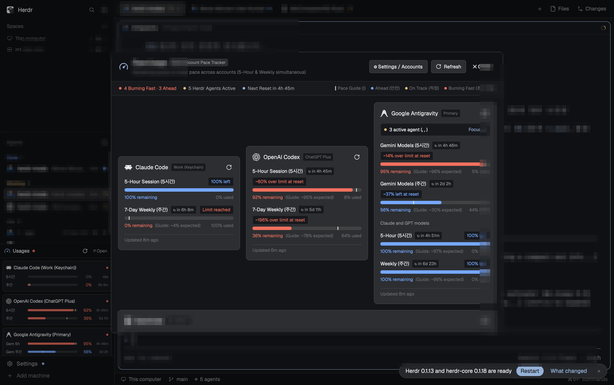

# 변경 이력 (Changelog)

이 프로젝트의 모든 주요 변경 사항은 이 문서에 기록됩니다. 버전 체계는 [Semantic Versioning](https://semver.org/lang/ko/)을 따릅니다.

---

## [v1.5.2] - 2026-11-06

레일 뷰(가장 좁은 사이드바) 중앙 프로바이더 앱 아이콘 및 상단 헤더 아이콘 크기 최적화 (18px -> 14px): 원형 게이지와의 여백 밸런스 개선.

### 🌟 주요 변경 사항 (Highlights)

1. **레일 모드 중앙 프로바이더 앱 아이콘 크기 축소 (`18px` -> `14px`)**
   - 듀얼 아크 게이지 링 내부에서 다소 크게 느껴지던 프로바이더 로고 크기를 `18px`에서 `14px`로 슬림화.
   - 게이지 안쪽 트랙과의 답답한 밀착을 해소하고, 사방에 단정한 여백(Breathing Room)을 확보하여 미니멀한 밸런스 완성.

2. **레일 상단 헤더 아이콘 크기 통일 (`16px` -> `14px`)**
   - 레일 최상단 `agent-usage` 속도계 헤더 아이콘도 `14px`로 통일하여 세로 열 전체의 시각적 일관성 확보.

---

## [v1.5.1] - 2026-11-06

페이스마크 틱 길이 컴팩트화 및 원형 게이지와 중앙 로고 간격 밀착(Snug Ring Fit): 위젯 일체감 극대화.

### 🌟 주요 변경 사항 (Highlights)

1. **페이스마크 틱 길이 단축 (Compact Dial Tick)**
   - 기존에 트랙 바깥으로 과도하게 돌출되던 페이스마크 길이(14px)를 단축하여 트랙 선폭(7.5px)에 알맞은 9.0px(`innerR = R - 4.5`, `outerR = R + 4.5`, `stroke-width 2.6`)로 슬림화.
   - 고급 시계 다이얼의 인덱스처럼 트랙에 단정하고 세련되게 밀착되는 형태 구현.

2. **원형 게이지와 중앙 로고 간격 밀착 (Snug Ring Fit)**
   - 게이지 기본 반지름을 `R = 48.0`에서 `R = 42.0`으로 축소하여 링을 안쪽으로 좁힘.
   - 중앙 프로바이더 벡터 로고 크기를 `15px`에서 `18px`로 확대.
   - 로고와 게이지 사이의 불필요하게 넓었던 검은 여백을 대폭 줄여, 로고를 아늑하게 감싸는 일체형 컴플리케이션 비주얼 완성.
   - 전체 500개 이상의 SVG 및 PNG 리소스 전면 재생성 완료.

3. **실물 스크린샷 갱신 및 검증 완료**
   - 레일 모드(`docs/screenshots/agent-usage-rail-v1.5.1-snug.png`) 실물 캡처 및 정상 작동 검증 완료.

---

## [v1.5.0] - 2026-11-06

원형 듀얼 아크 게이지에 페이스마크(Pace Mark 가이드라인 틱) 도입 및 초록색을 상징적인 파란색(Vibrant Blue `#3b82f6`)으로 전면 전환.

### 🌟 주요 변경 사항 (Highlights)

1. **원형 듀얼 아크에 페이스마크(Pacing Guideline Tick) 레이어 도입**
   - 상단(5시간/24시간) 및 하단(7일 주간) 아크 트랙 위에 시간 경과에 따른 소모 예상 기준점을 직교하는 선명한 화이트 틱(`opacity 0.95`, `stroke-width 3.5`)으로 표시.
   - 현재 잔여량(파란색 아크)이 페이스 틱보다 길면 쿼터 소모 속도가 안정적(Ahead/Healthy)임을 직관적으로 확인 가능.
   - `upper-tick-0..100.png` 및 `lower-tick-0..100.png` 202개 전용 고해상도 사전 래스터화 레이어로 GPUI 렌더링 성능과 안정성 완벽 확보.

2. **초록색 대신 시그니처 파란색(Vibrant Blue `#3b82f6`) 전면 적용**
   - 기존의 녹색(`#10b981`)을 생동감 있는 파란색(`#3b82f6`)으로 교체.
   - 다크 테마 배경에서 최적의 대비와 시인성을 제공하며, 주의(주황 `#f59e0b`), 위험/소진(빨강 `#ef4444`)과 선명한 3색 상태 체계 구축.

3. **호버 툴팁에 페이스 가이드 수치 추가**
   - 마우스 호버 시 표시되는 툴팁에 `(가이드: XX%)` 안내를 추가하여 정밀한 시간별 소비 진도 확인 가능.

4. **실물 스크린샷 갱신 및 검증 완료**
   - 레일 모드(`docs/screenshots/agent-usage-rail-v1.5.0-pace-marks.png`) 실물 캡처 및 정상 작동 검증 완료.

---

## [v1.4.0] - 2026-11-06

레일 모드 순수 원형 듀얼 아크 게이지(Pure Dual-Arc Gauge) 완성: 상하 숫자를 완전히 생략하고 48x48 정사각 아이콘 위젯으로 미니멀리즘 극대화.

### 🌟 주요 변경 사항 (Highlights)

1. **상하 텍스트 및 숫자 완전 제거 (Pure Icon Widget)**
   - 좁은 레일 폭(48px~68px)에서 시각적 번잡함을 유발하던 상하 숫자 텍스트를 완전히 제거.
   - 상단 5h/24h 80° 연속 아크(`⌒`)와 하단 7d 210° 대형 크래들 아크(`∪`), 그리고 중앙 프로바이더 공식 벡터 로고로만 구성된 순수 원형 게이지 위젯 완성.
   - 각 계정 버튼을 48x48 정사각형 비율로 조정하여 사이드바 상단 탭/공간 아이콘들과 완벽한 세로 격자 정렬(Grid Alignment) 달성.
   - 중앙 프로바이더 벡터 로고 크기를 15px로 균형감 있게 배치.

2. **호버 툴팁(Tooltip)을 통한 상세 수치 제공**
   - 위젯 자체는 군더더기 없는 순수 그래픽으로 유지하면서, 마우스 호버 시 5시간 및 7일 주간 잔여 % 수치(`• 5h 잔여: 79%`, `• 7d 잔여: 51%`)와 리셋 카운트다운을 풍부하게 표시.

3. **실물 스크린샷 갱신 및 검증 완료**
   - 레일 모드(`docs/screenshots/agent-usage-rail-v1.4.0-pure-gauge.png`) 실물 캡처 및 정상 작동 검증 완료.

---

## [v1.3.2] - 2026-11-06

원형 듀얼 게이지 위젯의 불필요한 `%` 기호 생략: 순수 잔여 숫자 표시로 시각적 가독성 극대화 및 미니멀 애플 워치/Status-Trio 스타일 구현.

### 🌟 주요 변경 사항 (Highlights)

1. **레일 모드 원형 게이지 상하 숫자에서 `%` 기호 생략**
   - 상단(5h/24h) 및 하단(7d) 표시 텍스트에서 번잡한 `%` 기호를 제거하고 순수 숫자(예: `79`, `51`, `0`)만 표시하도록 간소화.
   - 글자 폭 여유를 확보하여 폰트 크기를 확대(최대 10.5px 볼드)함으로써 멀리서도 한눈에 읽을 수 있는 글랜서블(Glanceable) 가독성 확보.
   - 마우스 호버 시 표시되는 툴팁(`tip`)에는 기존대로 상세 설명 및 단위(`잔여: 79%`)가 그대로 유지되어 정보 손실 없음.

2. **실물 스크린샷 갱신 및 검증 완료**
   - 레일 모드(`docs/screenshots/agent-usage-rail-v1.3.2.png`) 실물 캡처 및 정상 렌더링 확인 완료.

---

## [v1.3.1] - 2026-11-06

원형 듀얼 게이지 레이아웃 최적화: 5h(24h) 잔여 % 텍스트를 게이지 상단으로 배치하고, 7d 텍스트를 원형 게이지에 밀착 정렬하며 상단 아크를 매끄러운 연속 아크(Continuous Arch)로 정돈.

### 🌟 주요 변경 사항 (Highlights)

1. **5시간(5h / 24h) 잔여 % 텍스트 게이지 상단 배치**
   - 기존 원형 게이지 상단 노치 내부에 갇혀있던 5h % 텍스트를 게이지 원형 바깥 상단(`mb(-2)`)으로 이동 배치하여 하단 7d 텍스트와 완벽한 상하 대칭 구조 구현.
   - 폰트 크기를 가독성에 맞게 최적화(8px ~ 9.5px)하고, 쿼터 상태(녹색/주황/빨강/회색)와 1:1 동기화.

2. **7일(7d) 주간 잔여 % 텍스트 밀착 정렬**
   - 하단 7일 주간 % 텍스트의 간격을 게이지 하단 크래들에 가깝게 밀착(`mt(-2)`)하여 원형 위젯과의 일체감 대폭 향상.

3. **상단 아크 매끄러운 연속 아크(Continuous Arch `⌒`) 적용**
   - 텍스트가 게이지 상단으로 이동함에 따라 기존의 상단 텍스트용 50° 분리 갭을 없애고, 230°에서 310°까지(스팬 80°) 부드럽게 이어지는 단일 연속 아크로 개선.
   - 좌우 여백 갭이 각각 정확히 35°로 완벽한 좌우 대칭(Symmetry) 기하 구조 완성.
   - 0%~100% 상단/하단 게이지 308개 SVG 및 PNG 리소스 전면 재생성.

4. **실물 스크린샷 갱신 및 검증 완료**
   - 레일 모드(`docs/screenshots/agent-usage-rail-v1.3.1.png`) 실물 캡처 완료.

---

## [v1.3.0] - 2026-11-06

원형 듀얼 게이지 시각적 비례 직관화: 상단 5시간(5h/24h)은 짧은 아크(Short Arc), 하단 7일(7d)은 긴 크래들(Long Cradle)로 반전 적용.

### 🌟 주요 변경 사항 (Highlights)

1. **상단 5h 짧은 아크(Short Arc) & 하단 7d 긴 크래들(Long Cradle) 기하 구조 반전**
   - 5시간(5h, 짧은 기간)과 7일(7d, 긴 기간)의 시간적 스케일에 맞춰 게이지 길이 비례를 반전:
     - **상단 5시간(OpenCode: 24h) 게이지**: 상단 % 텍스트를 좌우에서 감싸는 컴팩트 윙 아크(좌 30° + 우 30° = 총 60° Short Arc)로 구성. 잔여량 0~50%는 좌측 윙, 50~100%는 우측 윙으로 채워짐.
     - **하단 7일(7d) 주간 게이지**: 하단 및 좌우를 웅장하게 감싸는 210° 대형 크래들 아크(9:30 방향에서 6시를 거쳐 2:30 방향까지)로 구성. 0~100% 잔여량에 따라 시계 방향으로 자연스럽게 채워짐.
   - 0%~100% 상단/하단/통합 게이지 총 308개 SVG 및 PNG 캐시 리소스 전면 재생성.

2. **검증 스크린샷 갱신**
   - 반전된 원형 듀얼 게이지 레일 모드(`docs/screenshots/agent-usage-rail-v1.3.0.png`) 및 표준 사이드바 모드(`docs/screenshots/agent-usage-standard-v1.3.0.png`) 실물 캡처 및 검증 완료.

---

## [v1.2.0] - 2026-11-06

Status-Trio 및 iPhone Duo 스타일 원형 듀얼 아크 게이지 레일 뷰 구현, 너비 기반 4단계 반응형 사이드바, 주간 쿼터 소진 시 비활성화 처리, GPUI Rust 렌더러 안정성 향상 및 공식 OpenAI 로고 전면 반영.

### 🌟 주요 변경 사항 (Highlights)

1. **iPhone Duo / Status-Trio 스타일 원형 듀얼 아크 게이지 (Rail View)**
   - 사이드바 너비가 140px 미만(44px~76px)일 때 컴팩트 원형 듀얼 게이지로 자동 전환.
   - **상단 5시간(또는 OpenCode 24h) 아크**: 7시에서 12시를 거쳐 5시 방향으로 이어지는 넓은 배터리 아크 게이지 (잔여량에 따라 0%~100% 매끄럽게 감소).
   - **상단 중앙 갭 숫자**: 아크 상단 갭(Gap)에 굵은 잔여 % 숫자 표시 (게이지 색상과 1:1 동기화: 🟢 녹색, 🟡 주황, 🔴 빨강, 회색).
   - **하단 7일(7d) 주간 스마일 아크**: 하단 미소(Smile) 곡선형 아크 게이지 및 하단 잔여 % 숫자 표시.
   - **중앙 프로바이더 공식 심볼**: OpenAI ChatGPT 공식 꽃무늬 로고, Claude Sparkle, Antigravity 'A', OpenCode 기호 배치.

2. **7일(7d) 주간 0% 소진 시 비활성화(Exhausted) 처리**
   - 주간 쿼터가 0%로 소진된 경우 5시간 쿼터가 남아있더라도 실제 API 호출이 불가능한 현실적인 제약을 반영:
     - **표준 모드**: 5시간 프로그레스 바가 채워지지 않고 비어있는 회색 바와 0%(`t.dim`)로 표시.
     - **레일 모드**: 상단 아크가 채워지지 않은 빈 회색 트랙(`upper-0.png`)으로 렌더링되며, 상단 텍스트 0%(`t.dim`), 중앙 아이콘도 dim 처리되어 쿼터 소진 상태임을 한눈에 직관적으로 알림.

3. **고해상도 사전 래스터화 PNG 게이지 파이프라인 (308개 파일)**
   - GPUI `image()` 컴포넌트의 벡터 SVG 렌더링 이슈를 원천 방지하기 위해 macOS `sips` 및 네이티브 SVG 기하 엔진(`helpers/duo_svg.py`)을 활용하여 0%~100% 상단/하단 아크를 144x144 고해상도 PNG 파일로 사전 빌드(`agent-usage/cache/`).

4. **공식 OpenAI ChatGPT 벡터 로고 채택**
   - 기존의 단순 박스/사각 형태 아이콘 대신 [LobeHub Icons](https://lobehub.com/icons) 공식 OpenAI ChatGPT 꽃/매듭 로고 벡터를 `agent-usage/icons/openai.svg` 및 `agent-usage/icons/codex.svg`에 전면 적용.

5. **GPUI Rust 타입 오류 및 렌더링 안정성 수정**
   - 선형 가이드라인 마커(`.left(guidePct + "%")`)에서 발생하던 Rust GPUI 크래시(`expected a number, got string`)를 해결하고, 비례 너비 flex spacer 기반 레이아웃 구조로 전면 교체.
   - 테마 토큰 미정의(`t.text` -> `t.foreground`) 타입 에러 해결.
   - 실시간 사이드바 리사이즈(`on_size_change`) 시 4단계 레이아웃(Rail `< 140px`, Narrow `140~230px`, Standard `230~320px`, Wide `>= 320px`)이 깜빡임 없이 즉시 전환되도록 최적화.

### 📸 검증 스크린샷

| 모드 | 스크린샷 |
| :--- | :--- |
| **표준 사이드바 (Standard View, 268px)** |  |
| **레일 모드 (Rail View, 68px)** |  |
| **대시보드 오버레이 (Dashboard Overlay)** |  |

---

## [v1.1.0] - 2026-11-05

- **4단계 반응형 사이드바 레이아웃 (Rail / Narrow / Standard / Wide)** 도입.
- **와이드 모드 (>= 320px)**: 5시간 및 주간 게이지 바를 좌우 2열 컬럼으로 나란히 배치.
- **Open 시 자동 새로고침 억제**: 대시보드 팝업 오픈 시 캐시된 데이터를 즉시 렌더링하고, 수동 새로고침(`Refresh ↻`) 버튼 제공.
- **다중 계정 관리 기능**: `~/.config/herdr-app/agent-usage-accounts.json` 지원 및 상단 설정(Settings) 다이얼로그 추가.

---

## [v1.0.0] - 2026-11-04

- **초기 Agent Usage (`agent-usage`) 모드 릴리스**.
- 4대 프로바이더(Claude Code, OpenAI Codex, Google Antigravity, OpenCode Go) 쿼터 조회.
- 5시간 세션 및 주간/월간 쿼터 잔여량 게이지 및 페이스 가이드라인(`|`) 구현.
- Herdr 활성 에이전트 목록 실시간 연동 및 포커스 이동 기능.
