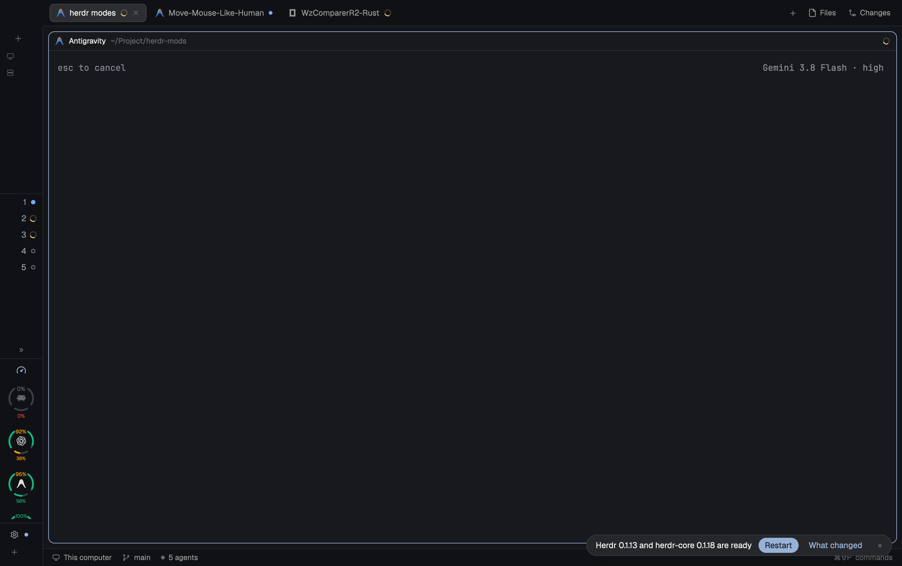

# 변경 이력 (Changelog)

이 프로젝트의 모든 주요 변경 사항은 이 문서에 기록됩니다. 버전 체계는 [Semantic Versioning](https://semver.org/lang/ko/)을 따릅니다.

---

## [v1.2.0] - 2026-11-06

Status-Trio 및 iPhone Duo 스타일 원형 듀얼 아크 게이지 레일 뷰 구현, 너비 기반 4단계 반응형 사이드바, 주간 쿼터 소진 시 비활성화 처리, GPUI Rust 렌더러 안정성 향상 및 공식 OpenAI 로고 전면 반영.

### 🌟 주요 변경 사항 (Highlights)

1. **iPhone Duo / Status-Trio 스타일 원형 듀얼 아크 게이지 (Rail View)**
   - 사이드바 너비가 140px 미만(44px~76px)일 때 컴팩트 원형 듀얼 게이지로 자동 전환.
   - **상단 5시간(또는 OpenCode 24h) 아크**: 7시에서 12시를 거쳐 5시 방향으로 이어지는 넓은 배터리 아크 게이지 (잔여량에 따라 0%~100% 매끄럽게 감소).
   - **상단 중앙 갭 숫자**: 아크 상단 갭(Gap)에 굵은 잔여 % 숫자 표시 (게이지 색상과 1:1 동기화: 🟢 녹색, 🟡 주황, 🔴 빨강, 회색).
   - **하단 7일(7d) 주간 스마일 아크**: 하단 미소(Smile) 곡선형 아크 게이지 및 하단 잔여 % 숫자 표시.
   - **중앙 프로바이더 공식 심볼**: OpenAI ChatGPT 공식 꽃무늬 로고, Claude Sparkle, Antigravity 'A', OpenCode 기호 배치.

2. **7일(7d) 주간 0% 소진 시 비활성화(Exhausted) 처리**
   - 주간 쿼터가 0%로 소진된 경우 5시간 쿼터가 남아있더라도 실제 API 호출이 불가능한 현실적인 제약을 반영:
     - **표준 모드**: 5시간 프로그레스 바가 채워지지 않고 비어있는 회색 바와 0%(`t.dim`)로 표시.
     - **레일 모드**: 상단 아크가 채워지지 않은 빈 회색 트랙(`upper-0.png`)으로 렌더링되며, 상단 텍스트 0%(`t.dim`), 중앙 아이콘도 dim 처리되어 쿼터 소진 상태임을 한눈에 직관적으로 알림.

3. **고해상도 사전 래스터화 PNG 게이지 파이프라인 (308개 파일)**
   - GPUI `image()` 컴포넌트의 벡터 SVG 렌더링 이슈를 원천 방지하기 위해 macOS `sips` 및 네이티브 SVG 기하 엔진(`helpers/duo_svg.py`)을 활용하여 0%~100% 상단/하단 아크를 144x144 고해상도 PNG 파일로 사전 빌드(`openusage/cache/`).

4. **공식 OpenAI ChatGPT 벡터 로고 채택**
   - 기존의 단순 박스/사각 형태 아이콘 대신 [LobeHub Icons](https://lobehub.com/icons) 공식 OpenAI ChatGPT 꽃/매듭 로고 벡터를 `openusage/icons/openai.svg` 및 `openusage/icons/codex.svg`에 전면 적용.

5. **GPUI Rust 타입 오류 및 렌더링 안정성 수정**
   - 선형 가이드라인 마커(`.left(guidePct + "%")`)에서 발생하던 Rust GPUI 크래시(`expected a number, got string`)를 해결하고, 비례 너비 flex spacer 기반 레이아웃 구조로 전면 교체.
   - 테마 토큰 미정의(`t.text` -> `t.foreground`) 타입 에러 해결.
   - 실시간 사이드바 리사이즈(`on_size_change`) 시 4단계 레이아웃(Rail `< 140px`, Narrow `140~230px`, Standard `230~320px`, Wide `>= 320px`)이 깜빡임 없이 즉시 전환되도록 최적화.

### 📸 검증 스크린샷

| 모드 | 스크린샷 |
| :--- | :--- |
| **표준 사이드바 (Standard View, 268px)** |  |
| **레일 모드 (Rail View, 68px)** |  |
| **대시보드 오버레이 (Dashboard Overlay)** |  |

---

## [v1.1.0] - 2026-11-05

- **4단계 반응형 사이드바 레이아웃 (Rail / Narrow / Standard / Wide)** 도입.
- **와이드 모드 (>= 320px)**: 5시간 및 주간 게이지 바를 좌우 2열 컬럼으로 나란히 배치.
- **Open 시 자동 새로고침 억제**: 대시보드 팝업 오픈 시 캐시된 데이터를 즉시 렌더링하고, 수동 새로고침(`Refresh ↻`) 버튼 제공.
- **다중 계정 관리 기능**: `~/.config/herdr-app/openusage-accounts.json` 지원 및 상단 설정(Settings) 다이얼로그 추가.

---

## [v1.0.0] - 2026-11-04

- **초기 OpenUsage 모드 릴리스**.
- 4대 프로바이더(Claude Code, OpenAI Codex, Google Antigravity, OpenCode Go) 쿼터 조회.
- 5시간 세션 및 주간/월간 쿼터 잔여량 게이지 및 OpenUsage 페이스 가이드라인(`|`) 구현.
- Herdr 활성 에이전트 목록 실시간 연동 및 포커스 이동 기능.
