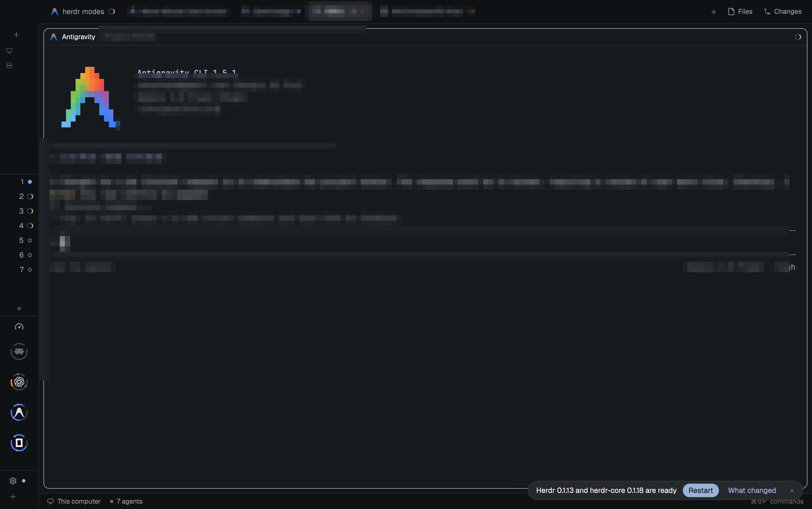
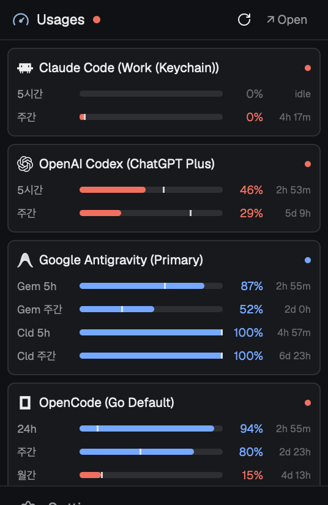
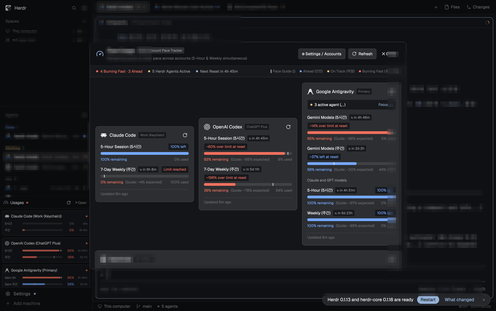

# 🐑 Herdr Mods

> Supercharge your [Herdr](https://herdr.dev) Agent Desktop App with high-performance, beautiful custom mods.

[](#)
[](#)
[](CHANGELOG.md)
[](LICENSE)

**Herdr Mods** is a curated collection of desktop extensions and workflow modules built with [GPUI](https://github.com/zed-industries/zed/tree/main/crates/gpui) for the **Herdr** coding agent workspace. 

The flagship mod in this repository is **Agent Usage** (`agent-usage`) — an intelligent, real-time AI quota monitor that consolidates 5-hour sessions, weekly limits, reset countdowns, and consumption pacing across all your AI coding agents directly in the Herdr sidebar and dashboard.

---

## 📸 Visual Showcase

Experience glanceable AI quota tracking across Herdr's adaptive workspace layouts:

| Ultra-Slim Rail (`< 160px`) | Standard Sidebar View (`268px`) | Full Dashboard Modal (`920x660`) |
| :---: | :---: | :---: |
|  |  |  |
| **Pure Dial Complication**<br/><sub>Concentric dual arcs, calibrated pacing tick, and snug-fit logo</sub> | **Detailed Metric Cards**<br/><sub>Linear progress bars, remaining %, countdown timers, and linear pacing markers</sub> | **Comprehensive Analytics**<br/><sub>Multi-account overview, consumption pacing diagnostics, and 1-click agent focus</sub> |

---

## ✨ Flagship Mod: Agent Usage (`agent-usage`)

### ⚡ Multi-Provider AI Quota Tracking
Monitor your active subscriptions and limits across top AI coding providers in one unified view:
- **Anthropic Claude Code**: 5-hour rolling session & 7-day weekly quota retrieved via macOS Keychain OAuth tokens.
- **OpenAI Codex**: 5-hour rolling window & 7-day limits retrieved from local session tokens (`~/.codex/auth.json`), with Plus/Pro tier detection.
- **Google Antigravity**: Real-time integration with `agy -p /usage`, showing separate bucket quotas for Gemini and Claude/GPT models.
- **OpenCode Go**: Multi-tier tracking for rolling, weekly, and monthly capacity via `opencode api`.

### 📊 4-Tier Adaptive Sidebar Layout
The widget automatically morphs into optimal layouts as you resize Herdr's sidebar:
- **Rail Mode (`< 160px`)**: Pure 48x48 icon buttons with concentric dual arcs:
  - **Upper Arc (5h/24h)**: An 80° smooth arch (`⌒`, 230°–310°) representing short-term session limits.
  - **Lower Arc (7d)**: A 210° deep cradle (`∪`, 195°–345°) representing weekly rolling quotas.
  - **Calibrated Pacing Ticks**: 9.0px dial index markers projected onto the tracks indicating expected remaining quota based on elapsed time.
  - **Glanceable Status**: Vibrant Blue (`#3b82f6`) for healthy quotas, Amber (`#f59e0b`) for caution, Crimson (`#ef4444`) for exhaustion, and Dimmed Grey when depleted.
  - **Zero Visual Clutter**: Clean geometry without distracting numeric text. Hover tooltips provide exact percentages and reset times.
- **Narrow Mode (`160px ~ 230px`)**: Compact stacked metric rows with abbreviated labels (`5h`, `7d`).
- **Standard Mode (`230px ~ 320px`, default 268px)**: Full metric bars, remaining percentages, linear pacing lines, and countdown clocks.
- **Wide Mode (`>= 320px`)**: Dual-column parallel layout rendering 5h and 7d metrics side-by-side, cutting vertical space consumption by 50%.

### ⏱️ Smart Pacing Engine
Don't get locked out before your reset time. The pacing engine calculates your consumption velocity against elapsed window time:
- 🔵 **Ahead / Healthy**: Consumption is slower than normal; comfortable quota remaining at reset time.
- 🟡 **On Track**: Consumption aligns closely with normal pace (~90–100% expected utilization).
- 🔴 **Burning Fast**: Burning through limits rapidly; alerts you before early exhaustion.

### 🔄 Instant Rendering & Zero-Lag Architecture
- **Non-blocking UX**: Opening the dashboard or switching views renders instantly from background cache (`shared("agent_usage.accounts_cache")`).
- **Silent Polling**: Background workers quietly update data every 2–5 minutes without interrupting your workflow.
- **Manual Force Refresh**: On-demand ↻ button with smooth spin animations when you want real-time verification.

### 👥 Multi-Account Profile Management
Track multiple personal, work, and team accounts per provider (e.g., `Claude (Work)`, `Claude (Personal)`, `Codex (Team)`):
- Interactive GUI configuration dialog (`⚙ Settings / Accounts`).
- Clean JSON backing file at `~/.config/herdr-app/agent-usage-accounts.json`.
- Customizable Keychain Service names and auth file paths per account.

---

## 🚀 Quick Start

### 1. Installation

Clone this repository and symlink the `agent-usage` mod into your Herdr configuration:

```bash
# Clone repository
git clone https://github.com/nanpuhaha/herdr-mods.git ~/Project/herdr-mods

# Create mods directory if it doesn't exist
mkdir -p ~/.config/herdr-app/mods

# Link agent-usage mod
ln -s ~/Project/herdr-mods/agent-usage ~/.config/herdr-app/mods/agent-usage
```

### 2. Add to Sidebar Layout

Edit your Herdr layout file (`~/.config/herdr-app/layouts/main.json`) and insert the `agent-usage` block inside the sidebar column:

```json
{
  "id": "sidebar",
  "type": "column",
  "size": { "px": 268 },
  "children": [
    { "id": "spaces", "type": "block", "content": { "mod": "spaces" } },
    { "id": "agents", "type": "block", "content": { "mod": "agents" } },
    { "id": "usages", "type": "block", "content": { "mod": "agent-usage" } }
  ]
}
```

### 3. Verify Installation

Run the Herdr GPUI syntax and runtime check:

```bash
herdr-app check ~/.config/herdr-app/mods/agent-usage
# Output: check passed: agent-usage
```

---

## 💡 Herdr Mod Commands

Control the mod directly from terminal or keybindings via `herdr-app do`:

```bash
# Toggle Agent Usage dashboard dialog
herdr-app do mod.open '{"name":"agent-usage"}'

# Open Agent Usage in a dedicated tab
herdr-app do tab.new '{"name":"Agent Usage","mod":"agent-usage"}'

# Split active pane to the right with Agent Usage
herdr-app do pane.split '{"direction":"right","mod":"agent-usage"}'
```

---

## ⚙️ Configuration (`agent-usage-accounts.json`)

Account profiles are stored in `~/.config/herdr-app/agent-usage-accounts.json`. You can edit this file manually or manage accounts through the in-app settings screen (`⚙ Settings / Accounts`).

```json
{
  "accounts": [
    {
      "id": "claude-main",
      "name": "Claude (Work)",
      "provider": "claude",
      "enabled": true,
      "keychain_service": "Claude Code"
    },
    {
      "id": "codex-main",
      "name": "OpenAI Codex",
      "provider": "codex",
      "enabled": true,
      "auth_path": "~/.codex/auth.json"
    },
    {
      "id": "agy-main",
      "name": "Google Antigravity",
      "provider": "antigravity",
      "enabled": true
    },
    {
      "id": "opencode-main",
      "name": "OpenCode Go",
      "provider": "opencode",
      "enabled": true
    }
  ],
  "poll_interval_seconds": 180
}
```

---

## 📂 Repository Structure

```
herdr-mods/
├── README.md                      # Project documentation (English)
├── CHANGELOG.md                   # Version history & release notes
├── docs/
│   ├── herdr-mod-guide.md         # Herdr Mod Development & API Reference (Korean)
│   └── screenshots/               # Interface validation screenshots
│       ├── agent-usage-rail-v1.5.1-snug.png
│       ├── agent-usage-standard-v1.3.0.png
│       └── agent-usage-overlay-v1.2.0.png
└── agent-usage/                     # Agent Usage mod source
    ├── mod.json                   # Mod declaration & dialog configuration
    ├── main.js                    # GPUI view component (Sidebar, Dashboard, Settings)
    ├── cache/                     # Pre-rendered high-DPI arc & tick assets (0%–100%)
    ├── helpers/                   # Python scrapers & SVG/PNG geometry engines
    │   ├── accounts.py            # Account CRUD manager
    │   ├── duo_svg.py             # Dual-arc geometry & tick rasterizer
    │   ├── claude.py              # macOS Keychain token reader
    │   ├── codex.py               # Session auth parser
    │   ├── antigravity.py         # agy CLI integration
    │   └── opencode.py            # opencode API integration
    └── icons/                     # Provider & UI vector assets (SVG)
```

---

## 🛠️ Developing Herdr Mods

Want to build your own custom mods for Herdr?
Consult the comprehensive [Herdr Mod Development Guide (Korean)](docs/herdr-mod-guide.md) for detailed documentation on:
- Herdr Architecture & Process Isolation (`herdr-core` vs `herdr-app`)
- Live Data & Act API reference (`spaces()`, `agents()`, `exec()`, `shared()`)
- GPUI styling chain methods & responsive layouts
- Mod testing and validation workflows

---

## 📜 Release History

See [CHANGELOG.md](CHANGELOG.md) for full details on releases, features, and fixes.
- **v1.5.1 (Current)**: Compact dial ticks (9.0px), snug-fit ring geometry (`R=42`), 18px vector logos.
- **v1.5.0**: Calibrated pacing tick guidelines on arc tracks, vibrant blue (`#3b82f6`) palette transition.
- **v1.4.0**: Pure dual-arc icon complication without text clutter.
- **v1.3.0**: Inverted top-5h arch / bottom-7d cradle orientation and 7d-dependent greying.
- **v1.2.0**: Official OpenAI ChatGPT knot vector logo integration.
- **v1.1.0**: 4-tier responsive sidebar layout & multi-account configuration UI.
- **v1.0.0**: Initial Agent Usage release with 4 AI providers.

---

## 📄 License

This project is licensed under the [MIT License](LICENSE).
Herdr and third-party trademarks are the properties of their respective owners.
